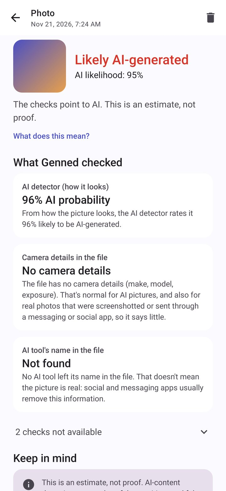
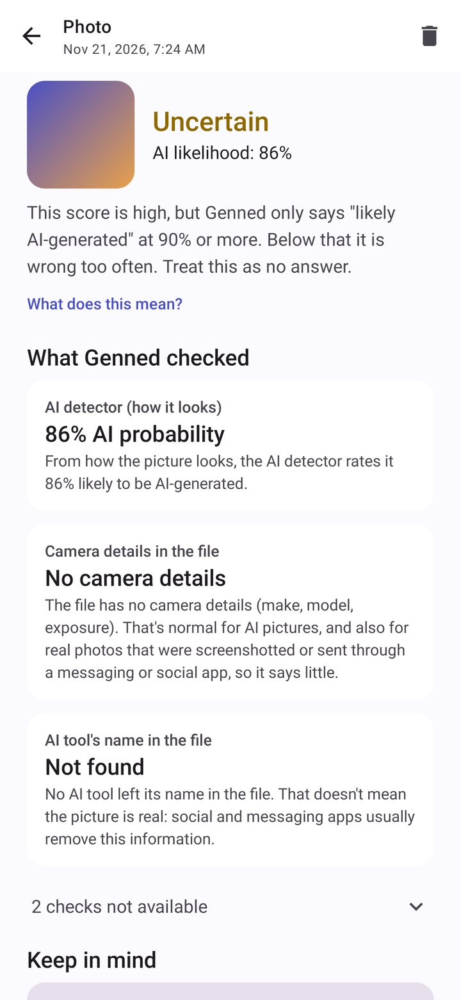
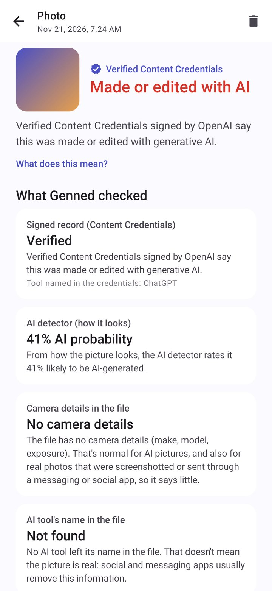
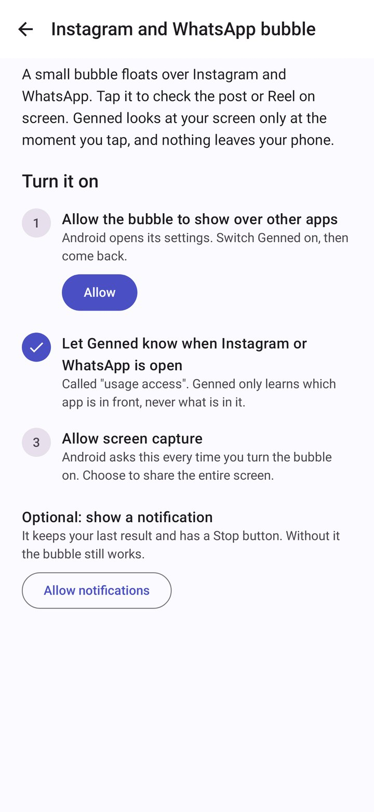

<p align="center">
  
</p>

<h1 align="center">Genned</h1>

<p align="center">
  <b>Is it real? Check before you share.</b><br>
  A free, open-source Android app that tells you whether a photo or video is likely
  AI-generated, in plain words, entirely on your phone.
</p>

<p align="center">
  <a href="https://github.com/as791/genned/releases/latest"></a>
  <a href="https://github.com/as791/genned/actions/workflows/android-ci.yml"></a>
  <a href="LICENSE"></a>
  
  
</p>

<p align="center">
  <a href="https://as791.github.io/genned/">Website</a> ·
  <a href="https://github.com/as791/genned/releases/latest">Download</a> ·
  <a href="#how-it-works">How it works</a> ·
  <a href="#accuracy">Accuracy</a> ·
  <a href="CONTRIBUTING.md">Contributing</a> ·
  <a href="PRIVACY.md">Privacy</a>
</p>

<p align="center">
  
  
  
  
</p>

> **Genned gives an estimate, not proof.** AI-content detection makes mistakes in both
> directions. Genned says "Uncertain" when it can't tell, and the
> [accuracy section](#accuracy) lists what it still gets wrong.

## Why

AI images and videos now look real enough to fool almost anyone: forwarded "news" photos
in family groups, flawless faces on Instagram and dating apps that belong to no one, viral
Reels of things that never happened. Genned gives you a second opinion before you believe,
forward or reply, without sending your photos anywhere.

## Features

- **Plain answers.** *Likely AI-generated*, *Uncertain* (with the reason), or
  *Likely not AI-generated*, plus every check behind it. Never "real" or "fake".
- **Works from any app.** Share a photo, screenshot or video (Reels, Shorts, up to
  3 minutes) from WhatsApp, Instagram, your gallery or any app with a Share button.
- **Instagram and WhatsApp bubble.** An optional floating bubble: tap it while you
  scroll to check what's on screen, without leaving the app.
- **Verified Content Credentials.** Signed C2PA records from cameras, editors and AI tools
  such as ChatGPT are verified on the phone against the official trust lists.
- **Private by design.** Every check runs on the device. The app has **no internet
  permission**, no account, no ads and no analytics.
- **Open and measured.** Every model change is benchmarked on held-out data in CI, and the
  numbers are published.

## Download

Genned isn't on Google Play yet. Get it from
[GitHub Releases](https://github.com/as791/genned/releases/latest) (Android 8.0 or newer):

1. On your phone, download `genned-<version>-arm64-v8a.apk` (nearly every phone from the
   last several years), or `genned-<version>.apk`, which is larger but works on every phone.
2. Open it, allow installs from your browser or Files app when Android asks, and tap
   Install.

Every release is signed with the same key and lists each APK's SHA-256. The app can't
check for updates (no internet), so watch the repository's releases and install a newer
APK over the old one; your history is kept.

## How it works

You share a photo or video into Genned, and several independent checks run on the phone.
Each one reports a score, or says honestly that it couldn't run; nothing is ever faked.

| Check | What it looks at |
|---|---|
| **AI detectors** | Two image models, EfficientNet-B4 and Community Forensics ViT-S, run with ONNX Runtime and combined into one calibrated score. Videos are checked on sampled frames. |
| **Content Credentials (C2PA)** | Signed records of how the file was made. A trusted "made with generative AI" or "captured with a camera" record decides the result outright. |
| **Generator metadata** | Tags that AI tools leave in EXIF or PNG chunks (Stable Diffusion parameters, Midjourney or DALL·E software strings). A match counts as evidence; no match proves nothing. |
| **Camera metadata** | Make, model and exposure fields: weak evidence for a real photo, because sharing apps strip them. |

The answer bands are set from benchmark data: *Likely AI-generated* at 90% or more,
*Likely not AI-generated* below 15%, and *Uncertain* in between, because that's where
detectors are wrong too often. Details are in
[`internal-docs/ARCHITECTURE.md`](internal-docs/ARCHITECTURE.md) and
[`internal-docs/MODEL.md`](internal-docs/MODEL.md).

## Accuracy

Measured on held-out test images the models never trained on (300 per class), with the
previous models re-run on the same images. Full results:
[issue #16](https://github.com/as791/genned/issues/16).

| v0.5.0 | Before | Now |
|---|---|---|
| Real phone photos shown "Uncertain" | 56% | 34% |
| Real phone photos wrongly shown "Likely AI-generated" | 3.3% | 0.7% |
| Newer AI generators (OpenFake): AI shown "Likely AI-generated" | 47% | 56% |
| Newer AI generators (OpenFake): AUC | 0.925 | 0.953 |
| AI images disguised as real by a universal adversarial pattern | 65% | 28% |

**Known limitations**

- Pictures from the newest closed AI tools are the hardest case, and often come out
  "Uncertain".
- Everyday edits (grain, sharpening, screenshots of screenshots) can hide AI: up to 13% of
  edited AI images still come out "Likely not AI-generated".
- Video is checked frame by frame, with no motion or audio analysis. On two video
  benchmarks the app catches 82% and 30% of AI videos at a 5% false-alarm rate; modern
  talking-head fakes remain hard.
- It is not robust to deliberate attacks. Someone with the model files can make it say
  anything.

## Building from source

Requirements: JDK 17 and the Android SDK with platform 36 (Android Studio installs both).

```bash
git clone https://github.com/as791/genned.git
cd genned
./gradlew assembleDebug                    # build a debug APK
./gradlew installDebug                     # install it on a connected phone or emulator
./gradlew testDebugUnitTest :domain:test   # unit and screenshot tests
```

The models ship in the repository (`app/src/main/assets/models/`, about 157 MB) and are
bundled at build time; the app never downloads anything. The Python tooling for
benchmarks and training is in `tools/` (`pip install -r tools/requirements.txt`).

## Project layout

| Path | What's there |
|---|---|
| `app/` | The Android app (Kotlin, Jetpack Compose): screens, detectors, the share target and the bubble |
| `domain/` | Pure-Kotlin core: evidence model and the engine that combines signals into a result |
| `tools/` | Python: benchmarks, calibration, model export and training (`tools/tests/` has its tests) |
| `notebooks/` | Training notebooks for GPU runs |
| `.github/workflows/` | CI: build and test, benchmarks, training, releases, the website |
| `site/` | The website at [as791.github.io/genned](https://as791.github.io/genned/) |
| `internal-docs/` | Architecture, model card and benchmark history, privacy design, roadmap, releasing |
| `release-notes/` | User-facing notes for each release |
| `store-listing/` | Screenshots, featured images and text for app stores |

## Contributing

Contributions are very welcome, especially from people working on Android, computer
vision or content provenance. Start with [CONTRIBUTING.md](CONTRIBUTING.md), then pick an
issue labelled
[`good first issue`](https://github.com/as791/genned/labels/good%20first%20issue) or
[`help wanted`](https://github.com/as791/genned/labels/help%20wanted).

Areas where help matters most:

- **Detection accuracy:** better on-device models, especially for the newest generators
  and edited images ([#16](https://github.com/as791/genned/issues/16)).
- **Video:** motion-aware or video-trained detectors small enough for a phone.
- **Android:** accessibility, translations (all text is in string resources), testing on
  more devices.
- **Store release:** the checklist in [#1](https://github.com/as791/genned/issues/1).

Three rules matter for every change: images never leave the device, results are never
faked, and changes to detection come with benchmark numbers, not anecdotes.

## Community

- **Questions and ideas:** [open an issue](https://github.com/as791/genned/issues/new/choose).
- **Wrong result?** Use the "Wrong result" issue template.
- **Security problems:** report them privately; see [SECURITY.md](SECURITY.md).
- Everyone taking part is expected to follow the [Code of Conduct](CODE_OF_CONDUCT.md).

## License and credits

Genned is licensed under the [Apache License 2.0](LICENSE).

- Models: [`Dafilab/ai-image-detector`](https://huggingface.co/Dafilab/ai-image-detector)
  (Apache-2.0) and Community Forensics ViT-S 224
  ([`OwensLab/commfor-model-224`](https://huggingface.co/OwensLab/commfor-model-224), MIT;
  Park & Owens, CVPR 2025), each bundled as published (for video) and as a copy retrained
  by this project for photos.
- Training data for the retrained copies: OpenFake (`ComplexDataLab/OpenFake`,
  CC-BY-SA-4.0, open-weights generators only), the Defactify dataset, and real phone photos
  from LAION-Mobile (`sumathiselvan/LAION-Mobile-streaming`).
- Libraries: ONNX Runtime Mobile (MIT); `contentauth/c2pa-android` with the C2PA Rust SDK
  (MIT/Apache-2.0); Kotlin, Jetpack Compose and AndroidX (Apache-2.0); JNA and OkHttp
  (Apache-2.0).
- Trust lists: the C2PA Trust List (CC-BY-4.0) and the Content Authenticity Initiative
  interim trust list.

The full list, with licence texts, is in the app under Settings → Open-source licenses.
